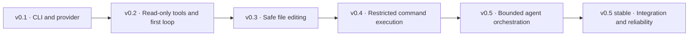
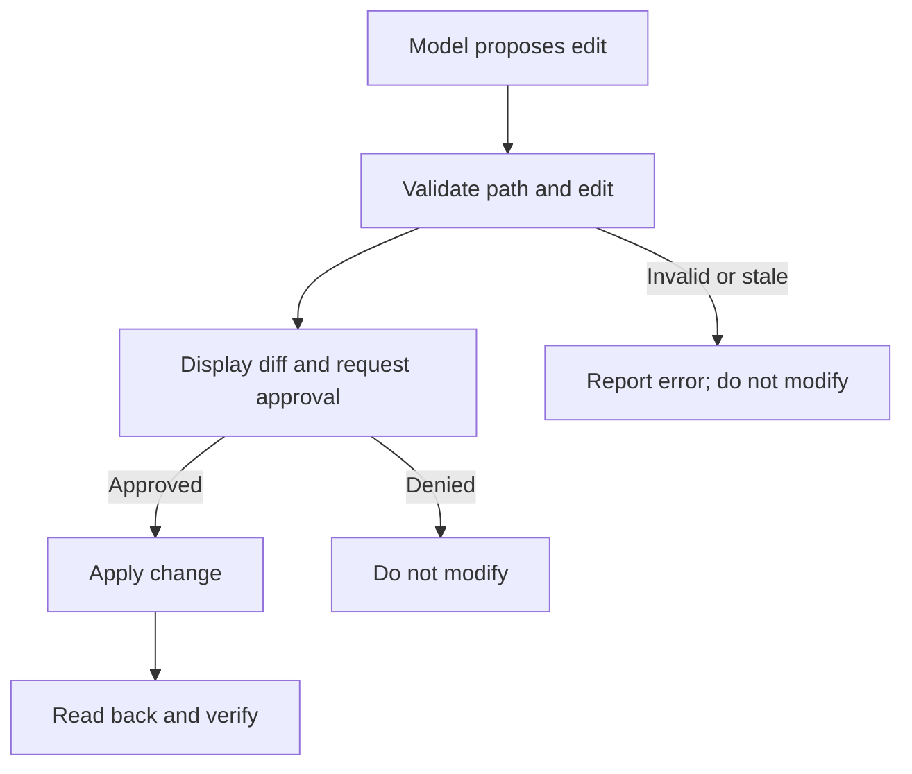
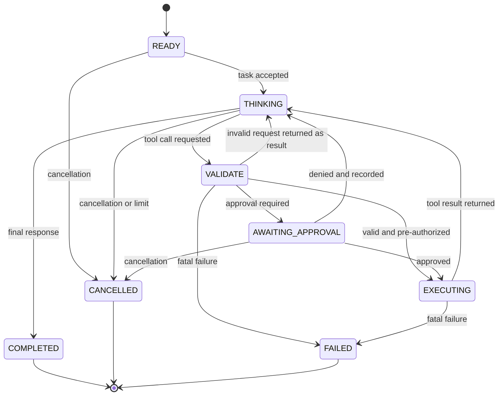
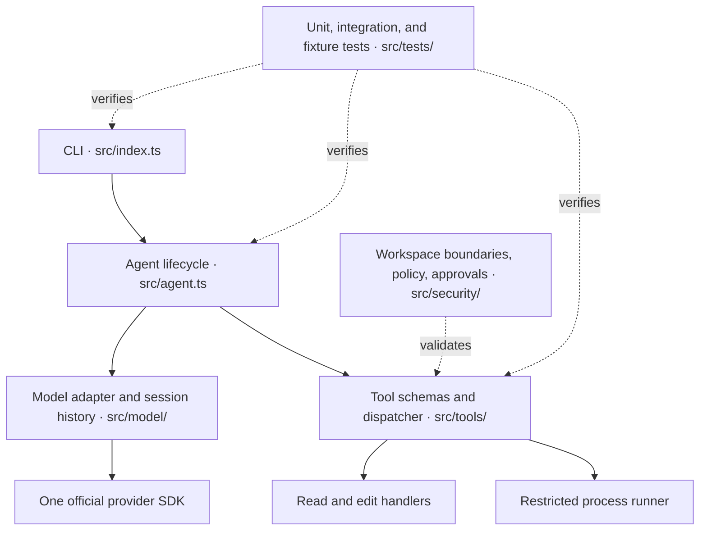

# Xcoder Stage 1 Engineering Plan

**Scope:** Xcoder v0.1–v0.5  
**Purpose:** Build and understand a small terminal-based coding agent using TypeScript, Node.js, one LLM provider, and Git.  
**Planning estimate:** 8–12+ hours across 2–4+ weeks, in focused 30–45-minute sessions. Estimates are flexible; finish and understand each phase before moving on.

## Product goal

By the end of Stage 1, Xcoder should be able to receive a bug-fixing task, inspect a project, identify relevant code, propose an edit, wait for approval, apply the approved change, run permitted tests, use their results, and report what it actually accomplished.

## Scope and engineering principles

Stage 1 adds capabilities incrementally:

- Accept natural-language coding tasks in a CLI.
- Inspect a selected workspace with bounded filesystem tools.
- Search source files and use findings in subsequent model requests.
- Propose edits and show diffs before applying them.
- Run a restricted set of development commands.
- Continue the model/tool cycle using tool results and test feedback.
- Handle errors, denials, approval pauses, cancellation, and execution limits.
- Verify outcomes with tests and Git diffs.

Four principles govern the implementation:

1. The model proposes; the application validates and executes.
2. Every tool has a defined schema and permission policy.
3. Every action produces an observable result.
4. Completion means verified results, not a confident-sounding answer.

## Roadmap at a glance



| Release | Focus | Estimate | Exit condition |
| --- | --- | --- | --- |
| **v0.1** | CLI and LLM integration | 1–2 sessions | Multi-turn conversation works; API errors and missing configuration are handled. |
| **v0.2** | Read-only tools and first agent loop | 2–3 sessions | Xcoder inspects real source files and answers using retrieved information. |
| **v0.3** | Safe file editing | 1–2 sessions | An approved edit changes only its intended target; a denied edit changes nothing. |
| **v0.4** | Restricted command execution | 1–2 sessions | Xcoder runs an approved test command and interprets its exit status correctly. |
| **v0.5** | Complete agent orchestration | 2–3 sessions | Xcoder completes a bounded bug-fixing workflow and reports verified results. |
| **v0.5 stable** | Integration and reliability | 1–2 sessions | Critical acceptance checks pass, or remaining limitations are documented. |

The agent loop is introduced in v0.2, then extended in every phase so new capabilities integrate into a working system.

## Detailed phase plan

### Phase 1 — CLI and LLM integration (v0.1)

**Objective:** Establish the smallest working foundation.

**Implementation tasks**

- Initialize a Node.js project with TypeScript.
- Configure the TypeScript compiler and development scripts.
- Install one provider's official SDK.
- Read the API key and model selection from environment variables.
- Build a CLI that accepts a user message and prints the model response.
- Maintain valid in-memory conversation history for the current session.
- Handle missing configuration, provider/API errors, and Ctrl+C.
- Exercise multiple consecutive messages.

**Definition of done:** Run Xcoder, exchange multiple messages with context preserved, handle API failures without losing prior history, and exit cleanly.

**Learning outcomes:** Message and history formats; SDK request/response flow; secret handling; and the distinction between configuration and provider errors.

**Do not add yet:** Filesystem tools, editing, command execution, or a complex class hierarchy.

**Likely files:** `src/index.ts`, `src/model/`, `.env.example`, `.gitignore`, `package.json`, and `tsconfig.json`.

### Phase 2 — Read-only tools and first loop (v0.2)

**Objective:** Let the model request workspace information and use the returned results.

Start with three tools:

| Tool | Purpose |
| --- | --- |
| `list_files` | List files and directories within the configured workspace. |
| `read_file` | Read a bounded amount of file content. |
| `search_files` | Find matching text in eligible source files. |

**Implementation tasks**

1. Define tool names, descriptions, and runtime-validated argument schemas.
2. Register tools with the chosen provider's tool-calling interface.
3. Add a central tool dispatcher and safe filesystem handlers.
4. Restrict every path to the configured workspace root.
5. Exclude sensitive files and noisy directories by default.
6. Bound file sizes, tool output, model iterations, and repeated calls.
7. Return results in the provider's required conversation format.
8. Handle multiple tool calls when the provider returns them.
9. Test against a real TypeScript repository.

**Important:** A model tool call is a request, not execution. The application validates the request, runs the handler, and returns the result in the provider's required format.

**Definition of done:** Ask Xcoder to find and inspect a function in a test repository, then explain a bug using information retrieved through its tools.

### Phase 3 — Safe file editing (v0.3)

**Objective:** Enable controlled modifications without silently damaging a workspace.

**Implementation tasks**

- Implement a bounded patch or file-edit operation.
- Validate every write path against workspace boundaries, including symlinks and filesystem edge cases.
- Prepare a change proposal and show a diff preview.
- Require explicit user approval before applying edits.
- Detect if a target changed after the proposal was prepared.
- Apply only the approved change, then read it back and report verification results.
- Inspect Git diffs in tests.



**Definition of done:** Approve one edit, deny another, and verify that the approved edit changes only its intended target while the denied edit changes nothing.

### Phase 4 — Restricted command execution (v0.4)

**Objective:** Let Xcoder run development checks and observe their results.

**Implementation tasks**

- Define an allowlist of executable-and-argument combinations.
- Run processes with `node:child_process`; disable shell execution where practical.
- Control working directory and environment.
- Capture stdout, stderr, and exit code separately.
- Enforce timeouts and bounded output.
- Support cancellation and process termination.
- Require approval for commands with meaningful side effects.
- Return structured command results to the model.

Start with a narrow set of test and build commands. Do not expose an unrestricted shell for convenience.

**Definition of done:** Xcoder runs a permitted test, recognizes success or failure, responds appropriately to a failure, and rejects an unauthorized command.

### Phase 5 — Complete agent orchestration (v0.5)

**Objective:** Combine inspection, edits, commands, and feedback into a bounded coding agent.

**Agent cycle**



At every stage, cancellation, fatal failure, or an exhausted limit can stop the task. A denial must never silently become authorization.

**Required controls**

- Maximum model/tool iteration count, tool-call count, and execution deadline.
- Provider-correct message history and matching tool-call/result records.
- Explicit handling for failed, denied, and malformed tool calls.
- Cancellation and approval pauses that preserve task state.
- Final reporting that distinguishes verified results from unresolved work.
- An explicit state machine rather than scattered orchestration logic.

**Definition of done:** Xcoder inspects a bug, proposes a fix, waits for permission, modifies the code, runs tests, uses test feedback to decide what to do next, and reports the outcome accurately without exceeding its limits.

### Phase 6 — Integration and reliability (v0.5 stable)

**Objective:** Establish that the complete workflow is dependable enough for controlled use.

Create a disposable Git repository with a deliberately introduced bug and a known expected outcome. Run these checks:

- Successful bug-fixing task.
- Task requiring inspection of several files.
- Invalid or malformed tool request.
- Missing file or inaccessible path.
- Path-traversal or symbolic-link escape attempt.
- Denied file edit.
- Prohibited command.
- Failing test followed by a repair attempt.
- API error or malformed model response.
- Loop reaching its configured limit.
- Cancellation during a long-running operation.
- Final Git diff inspection for unintended changes.

**Release criteria:** All critical acceptance checks pass, the final diff is reviewed, and documented limitations are accurate. A commit is optional and remains a user decision.

## Target architecture and folder structure

Add modules only when a phase needs them; do not create empty modules just to match the target layout.



```text
xcoder/
├── src/
│   ├── index.ts             # CLI input and output
│   ├── agent.ts             # Agent lifecycle and bounded loop
│   ├── model/               # Provider adapter, requests, message history
│   ├── tools/               # Schemas, dispatcher, filesystem and process handlers
│   ├── security/            # Workspace boundaries, permissions, approvals
│   └── tests/               # Unit tests, integration tests, fixtures
├── .env.example             # Configuration template; never real credentials
├── .gitignore               # Secret and generated-file exclusions
├── package.json
└── tsconfig.json
```

A separate `permissions.ts`, test fixtures, or more granular handlers can be introduced later when the design warrants them.

## Progress tracker

Use these 30 outcomes to track Stage 1 progress. Mark an item complete only after it is implemented and verified.

### Phase 1 — CLI and LLM

- [ ] Initialize Node.js and TypeScript.
- [ ] Connect one model provider.
- [ ] Accept terminal input and print responses.
- [ ] Preserve session conversation history.
- [ ] Handle API errors and cancellation.

### Phase 2 — Read-only tools and first loop

- [ ] List workspace files safely.
- [ ] Read bounded file contents safely.
- [ ] Search eligible file contents.
- [ ] Register and validate tool schemas.
- [ ] Execute tools and return results to the model.

### Phase 3 — File editing

- [ ] Implement a bounded patch or write operation.
- [ ] Validate paths and workspace boundaries.
- [ ] Preview changes as diffs.
- [ ] Require explicit approval for edits.
- [ ] Verify applied changes and detect stale proposals.

### Phase 4 — Command execution

- [ ] Implement restricted process execution.
- [ ] Capture stdout and stderr.
- [ ] Capture exit codes.
- [ ] Enforce timeouts and output limits.
- [ ] Handle denied commands and failed processes.

### Phase 5 — Agent orchestration

- [ ] Repeat model and tool calls correctly.
- [ ] Maintain valid provider message history.
- [ ] Enforce iteration and execution limits.
- [ ] Support cancellation and approval pauses.
- [ ] Produce an accurate final summary.

### Phase 6 — Integration and reliability

- [ ] Test against an intentionally buggy repository.
- [ ] Verify a successful fix with tests.
- [ ] Test invalid tool arguments and denied paths.
- [ ] Test command restrictions and cancellation.
- [ ] Review the final Git diff and document limitations.

## Recommended technology stack

Keep the stack deliberately small; the agent itself is the engineering focus.

| Component | Choice |
| --- | --- |
| Language | TypeScript |
| Runtime | Node.js |
| CLI | Node.js standard input/output initially |
| LLM integration | One provider's official SDK |
| Runtime tool validation | Zod or an equivalent schema validator |
| Filesystem | `node:fs/promises` and Node path APIs |
| Process execution | `node:child_process` |
| Testing | Node.js built-in test runner or Vitest |
| Version control | Git |
| Configuration | Environment variables |

Install only what the current phase needs. LangChain, LangGraph, agent frameworks, databases, and vector stores are outside this plan's initial scope.

## Security requirements

These requirements apply throughout Stage 1:

- **Workspace isolation:** Resolve and validate paths against the configured project root; account for symlinks and filesystem edge cases.
- **Least privilege:** Give each tool only the access it needs.
- **Explicit approval:** The model cannot approve its own proposed operations.
- **Command restrictions:** Do not expose arbitrary shell execution or assume familiar commands are harmless.
- **Resource limits:** Bound execution time, tool calls, file sizes, and returned output.
- **Secret protection:** Do not expose API keys, environment files, or credentials through tools; never commit real secrets.
- **Honest reporting:** Distinguish proposed, attempted, successful, and verified actions.

Path checks alone are not a complete security sandbox. Symlink races, subprocess behavior, and project scripts can cross boundaries if the environment permits them. Use a disposable repository and restricted execution environment during Stage 1; do not trust the agent with important projects.

## First implementation session

Keep the first session limited to a tiny, working CLI. Do not start Phase 2, create every future directory, or generate the whole project in one pass.

### Session 1 — Xcoder v0.1

- [ ] Create the Xcoder project directory and initialize Git.
- [ ] Initialize Node.js and configure TypeScript.
- [ ] Configure environment variables and `.gitignore`.
- [ ] Install one provider SDK and connect the API.
- [ ] Accept one terminal message and print the model response.
- [ ] Run one successful check and confirm secrets are not committed.

**Stopping point:** Xcoder runs, accepts a message, receives a model response, and exits cleanly. After that, add conversation history, then the first read-only tool and the smallest possible agent loop.

## Learning resources

- [TypeScript Handbook](https://www.typescriptlang.org/docs/)
- [Node.js API documentation](https://nodejs.org/docs/latest/api/)
- [OpenAI API documentation](https://platform.openai.com/docs/overview)
- [OpenAI Codex repository](https://github.com/openai/codex)
- [Anthropic tool-use documentation](https://docs.anthropic.com/en/docs/tool-use/overview)

Use provider-specific documentation for tool-call formats, result messages, and continuation rules. Implement one provider correctly before designing a multi-provider abstraction.
